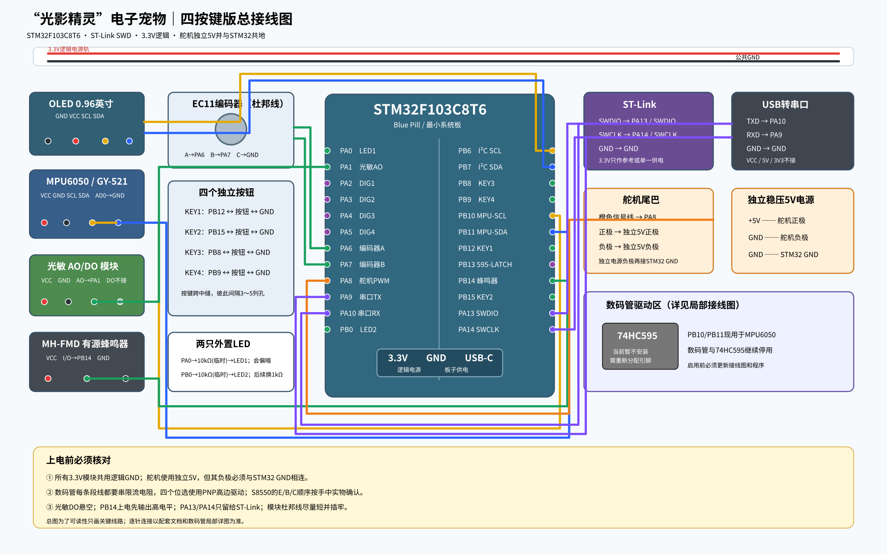

# 光影精灵 STM32 电子宠物

基于 STM32F103C8T6 的桌面电子宠物，结合 OLED 中文表情、光照与运动感知、舵机尾巴和串口诊断，展示从硬件接线到应用状态机的实现过程。

上图为接线示意。数码管属于后续扩展，当前固件未接入；实物照片与演示视频待补充。

## 项目内容

| 模块 | 实现内容 |
|---|---|
| 交互 | 喂食、玩耍、睡眠、状态页、旋转编码器与四个按键 |
| 显示 | I²C OLED 中文界面、表情与启动动画 |
| 感知 | 光敏 ADC、MPU6050 运动检测、掉线重试 |
| 执行 | 舵机尾巴、LED、蜂鸣器与舵机角度限制 |
| 调试 | USART 命令、状态查询、I²C 扫描与 MPU 诊断 |

## 快速开始

1. 查看 [引脚与供电说明](light-sprite-pet/wiring/接线与引脚表.md)，按当前版本接线。
2. 用 Keil uVision 5 打开 [Project.uvprojx](light-sprite-pet/Project.uvprojx)，选择 **Stage6**，编译后通过 ST-Link SWD 下载。
3. 打开串口终端，设置 **115200、8N1、无流控**，发送 `PING`、`STATUS`、`SENSOR STATUS`（以回车或换行结束）。

已记录构建环境：MDK 5.34、ARMCC 5.06 update 7；[现有 Stage6 构建日志](light-sprite-pet/build-evidence/Keil_Stage6_Build.log) 为 0 error、0 warning。该日志对应原始发布快照，源码修订后需要重新编译和实板验收。

已有 [Stage6 HEX](light-sprite-pet/release/light_sprite_stage6.hex) 对应原始 PB10/PB11 MPU 接线版本，**不包含后续源码修复**。需要最新行为时请从当前源码重新构建。

## 硬件与供电

STM32F103C8T6、0.96 英寸 I²C OLED、MPU6050、光敏模块、舵机、旋转编码器、四个按键、两颗 LED、低电平触发蜂鸣器，以及 ST-Link 和 USB 转串口模块。LED 需要串联限流电阻。

舵机使用独立 5V 电源，并与 STM32 共地；OLED 与 MPU6050 按接线文档使用 3.3V。ST-Link 的 3.3V 不作为舵机电源。

## 阅读入口

- [完整功能、操作与编译说明](light-sprite-pet/README.md)
- [串口与现场验收](light-sprite-pet/docs/串口与现场验收.md)
- [项目总结](light-sprite-pet/docs/项目总结.md)
- [主程序](light-sprite-pet/User/main.c) / [传感器处理](light-sprite-pet/User/sensors.c)
- [主机回归测试](light-sprite-pet/tests/README.md)

## 验证与后续计划

现有仓库保留 Keil 构建证据；主机测试覆盖运动差值边界、采样失败和重连基准。传感器阈值、舵机动作与长时间运行仍需在实体板上验证。后续补充实物演示、重新构建的固件版本，以及逐项实板验收结果。

STM32 标准外设库遵循随附的 [ST 许可](light-sprite-pet/Library/License.doc)。项目应用代码当前未单独设置开源许可证。
