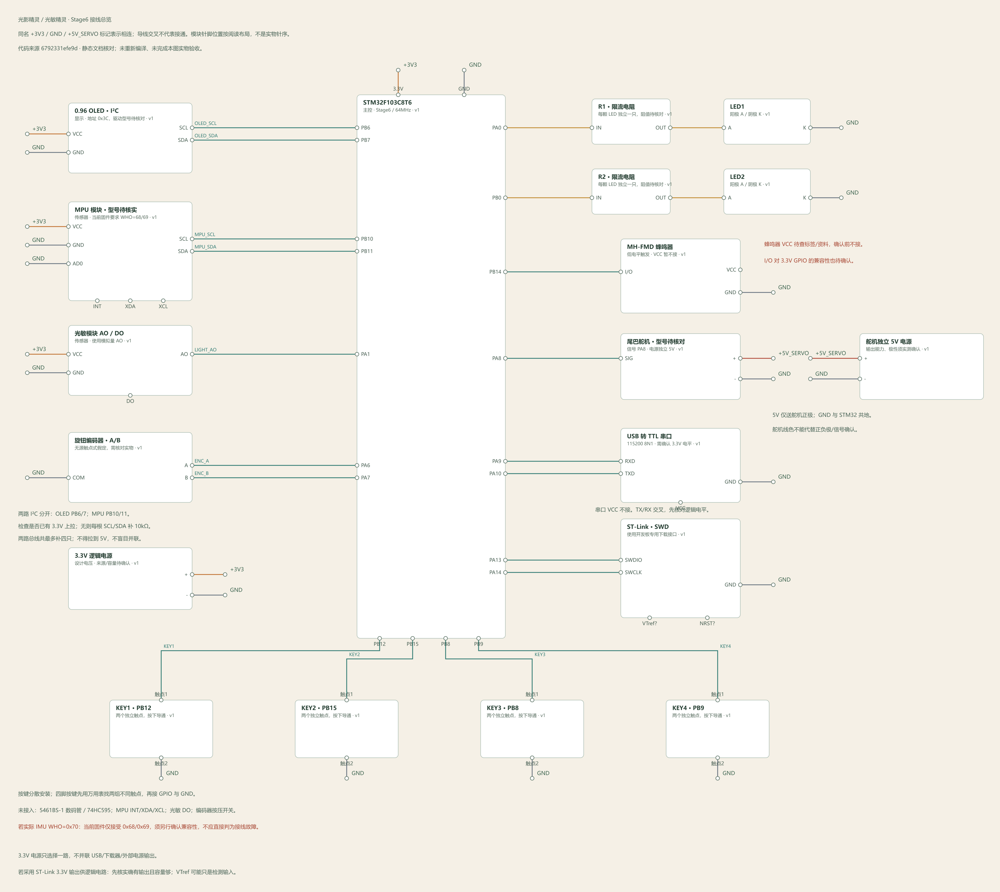

# 光影精灵：接线工作台资料

本目录使用 [接线工作台 Wiring Workbench](https://github.com/9595846/wiring-workbench) 的实际项目模型、静态检查器、MCP 与网页 PNG 导出功能生成。对应本仓库 `light-sprite-pet` 的 **Stage6**，核对基线为提交 [`6792331efe9d`](https://github.com/9595846/e-chip-2026-stm32-assessment/tree/6792331efe9d0f9f09516398777d2d3947f9dce7/light-sprite-pet)，整理日期 2026-11-09。

## 先看图，再按表接线

图上的模块针脚位置为了讲解而重新排列，**不是开发板真实针序或面包板孔位**。按模块丝印找同名针脚。相同的 `GND`、`+3V3`、`+5V_SERVO` 网络标记表示相连；不同名称不能混接。电源分配可使用可靠的分配排或面包板电源轨，分段电源轨要先测通断。

| 文件 | 用途 |
|---|---|
| [SVG 接线图](wiring_overview.svg) / [PNG 接线图](wiring_overview.png) | SVG 可任意放大；PNG 方便展示。两者来自同一份模型，网页 PNG 额外显示信号线名称 |
| [可编辑项目 JSON](light_sprite_pet.wiring.json) | 工作台点击“导入 JSON”，继续移动模块、改针脚、接线与检查 |
| [大白话接线说明](接线说明.md) | 逐个模块解释哪根线接哪里，含供电、上拉和未接针脚 |
| [逐根接线表](wiring_table.md) / [CSV](wiring_table.csv) | 46 条实际绘制的连接；同名网络标记负责合并电源/地 |
| [检查报告](检查报告.md) | 代码证据、资源核对、兼容性问题、未知项与排查办法 |
| [验收清单](验收清单.md) | 按上电顺序操作，留空记录实体测试结果 |
| [物料清单 CSV](bom.csv) | 必需模块、数量、待核对参数和条件安装电阻 |
| [电气检查 JSON](electrical_checks.json) | 工作台原生静态检查结果 |
| [Keil 只读扫描 JSON](keil_readonly_scan.json) | GPIO 候选证据与扫描器无法判断的内容；不等同编译或完整解析 |
| [源码证据 JSON](source_evidence.json) | 按文件、行号列出人工核对用的代码证据 |
| [静态验证 JSON](verification.json) | 26 项文件/网络检查记录；明确标记未执行 Keil 与实体测试 |
| [生成来源](mcp_provenance.json) / [文件哈希](manifest.json) | MCP 项目标识、工具版本依据和交付文件指纹 |

## 在工作台继续编辑

1. 打开接线工作台，先保存自己正在编辑的其他图纸。
2. 点击“导入 JSON”，选择 `light_sprite_pet.wiring.json`。这是工作台项目文件，不能放进 Keil 编译。
3. 点击“另存副本”或保存为自己的项目。原有全局模块库和其他项目不受此文件影响。
4. 点击模块或针脚查看用途、电压和电气属性；点击导线/网络标记可整网高亮。供电短线/完整走线仅改变显示。
5. 确认实物参数后再补齐未知属性，重新检查并导出 SVG、PNG、CSV 和报告。更改接线图不会自动改固件。

本次也在当前本机的 MCP 工作区和桌面套件接线工作台数据区保存了“光影精灵 · Stage6 接线与核对”。换电脑时以此目录内 JSON 导入即可，不依赖本机项目编号。

## 当前不能省略的确认

- **蜂鸣器**：VCC 电压及 I/O 电平兼容性未确认，图中有意不接 VCC，检查器保留警告。确认之前整块蜂鸣器先不要接入；不能照图通电就期望它响。
- **IMU**：固件只接受 `WHO_AM_I=0x68/0x69`；若实际模块读出 `0x70`，总线有 ACK 也会被拒绝。此处未修改驱动。
- **供电**：3.3V 来源/容量、独立 5V 的输出能力、USB-TTL 电平和总线上拉均需实物确认。图中标注的是设计电压，并非测量结果。

这次新增的是图纸与文档。未更改 `.uvprojx`、C/H、启动文件或 HEX；未重新执行 Keil 编译、烧录与实体板验收。
