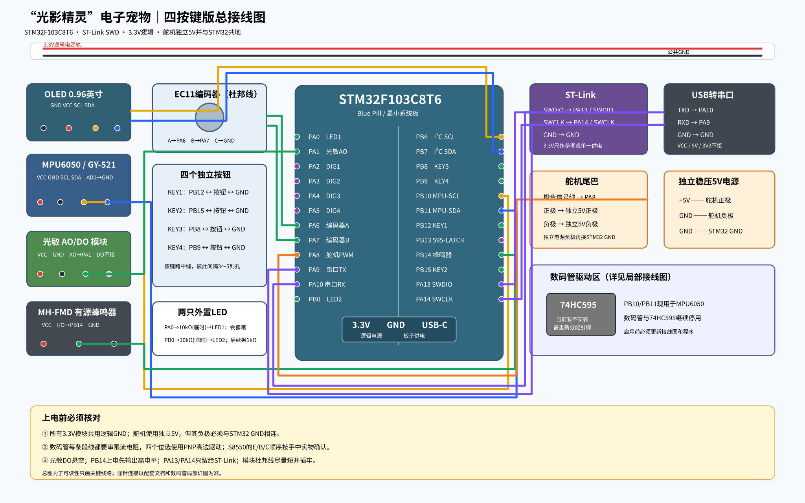
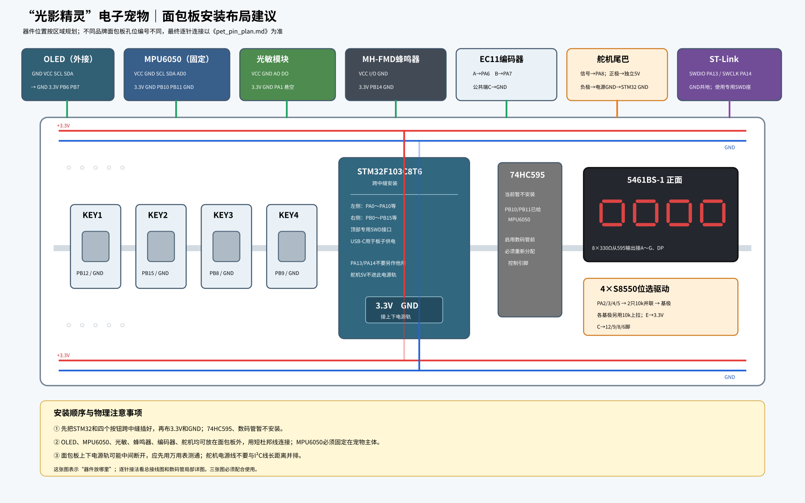
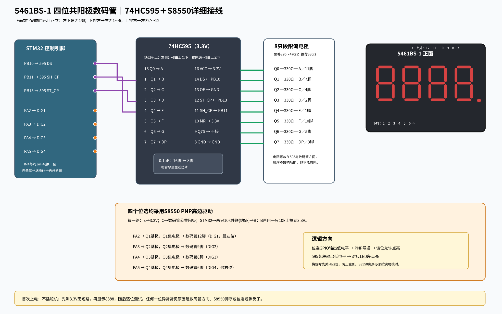

# 光影精灵接线与引脚表

本图文对应 STM32F103C8T6、OLED、编码器、四按钮、光敏模块、MPU6050、蜂鸣器、LED、舵机和 ST-Link。GPIO 与最终固件版本对照；布线前仍要核对手上模块丝印和供电规格。

## 大白话接线表

| STM32 端 | 另一端 | 说明 |
|---|---|---|
| 3.3V / GND | OLED VCC / GND | OLED 逻辑供电 |
| PB6 / PB7 | OLED SCL / SDA | OLED 的 I²C 时钟/数据 |
| 3.3V / GND | MPU6050 VCC / GND | 传感器供电和地 |
| PB10 / PB11 | MPU6050 SCL / SDA | MPU6050 软件 I²C；不要和 OLED 两线接反 |
| GND | MPU6050 AD0 | 选择常用 I²C 地址 0x68；INT/XDA/XCL 暂不接 |
| PA1 | 光敏模块 AO | 读取亮度模拟值；DO 可悬空 |
| 3.3V / GND | 光敏模块 VCC / GND | 逻辑供电 |
| PA6 / PA7 | 编码器 A / B | 编码器公共端接 GND |
| PB12 / PB15 / PB8 / PB9 | KEY1 / KEY2 / KEY3 / KEY4 | 每个按键另一端接 GND；软件内部上拉 |
| PA0 / PB0 | LED1 / LED2 | 每个 LED 必须串联限流电阻后再接；短脚/阴极接 GND |
| PB14 | MH-FMD 的 I/O | 低电平触发，模块 VCC/GND 按模块标识供电 |
| PA8 | 舵机信号线 | 常见橙色，但先核实具体型号定义 |
| 独立 5V + GND | 舵机电源正 + 负 | 舵机电流由独立 5V 提供；该 GND 再连 STM32 GND，共地 |
| PA9 / PA10 / GND | USB-TTL RXD / TXD / GND | TX/RX 交叉；TTL VCC 通常不接 |
| 板载 SWDIO / SWCLK / GND | ST-Link SWDIO / SWCLK / GND | 仅下载/调试；不要占用这两根线作普通 IO |

## 供电与信号注意

- 舵机三根线通常是信号、电源正、电源负；不同厂商颜色可能不同。不能只凭浅红/深红颜色判断正负，应查标签、型号资料或按插头标注确认。
- 舵机正极接独立 5V，舵机负极接电源 GND；独立电源 GND 必须连 STM32 GND。信号线接 PA8。不要让舵机从 STM32 3.3V 或 ST-Link 取电。
- OLED、MPU6050 的 I²C 上拉只允许拉到 3.3V。若模块没有板载上拉，SCL 与 SDA 各用一只 10 kΩ 电阻上拉到 3.3V。
- 四脚轻触按键请跨面包板中间沟槽放，且不同按钮之间留出间隔，避免同侧脚插入同一连通排导致短接或接触不良。
- LED 电阻串在 LED 回路中；每个 LED 各一只。不可把 GPIO 直接接 LED 再接地。

## 数码管扩展（本固件未启用）

5461BS-1 暂不接入，因为缺少 74HC595；数码管图片和引脚资料只是将来扩展参考。请不要依据图中旧预留信号把数码管接到 MPU6050 正在使用的 PB10/PB11，也不要期望当前固件点亮它。

## 接线图片

### 总览

### 面包板布局

### 数码管针脚参考（未接入）

